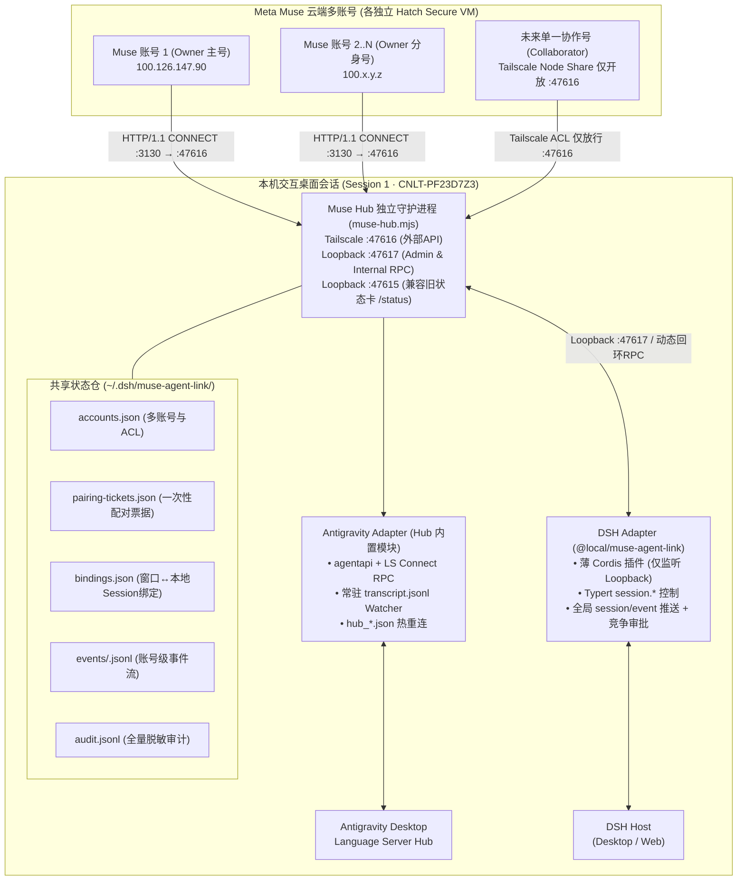
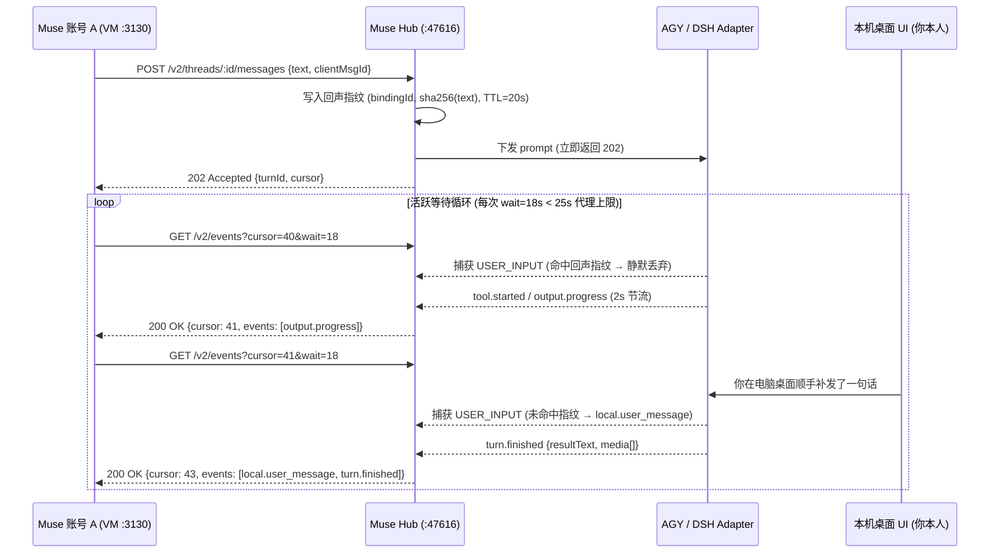

# Muse Agent Link v2 (`Muse Hub`) 完整协议与架构规范

- **版本**：`v2.0-draft`（2026-11-23）
- **适用范围**：单机多宿主（`Antigravity Desktop` + `DSH Desktop/Web`），支持多 `owner` 级 Muse 账号与预留单一 `collaborator` 协作账号
- **兼容基线**：完全向后兼容 `v0.6.0`（`/api/muse-agent-link/*` 与原 `state.json` 单 Token），零停机平滑升级
- **目标首台落地机**：`CNLT-PF23D7Z3`（`100.117.132.86`），同步兼容 `office-workstation`（`100.91.205.57`）

---

## 1. 设计背景与硬约束（实测核验）

| 约束来源 | 实测事实 | 对协议的强制要求 |
| :--- | :--- | :--- |
| **Meta Muse Tailscale 连接器** | 严格纯出站（Outbound-Only），Muse 云端 VM 不接受任何入站连接 | 所有控制与取件连接必须由 Muse 主动发起，不存在直连 Webhook |
| **Meta Hatch 隧道代理 `:3130`** | Muse VM 经 `HTTPS_PROXY` 的 `:3130` `HTTP CONNECT` 访问 tailnet，长连接约 **25s** 被代理切断 | 放弃常驻 WebSocket / 长时间阻塞 SSE；统一使用 **短长轮询（`wait <= 20s`，默认 `18s`）+ 单调 `cursor`** |
| **Antigravity Desktop 凭据会话** | 桌面应用 Language Server Hub 与登录凭据位于 Windows 交互会话（Session 1），Windows Service（Session 0）无法读取 | `muse-hub` 必须通过 `HKCU\...\Run` 运行于用户交互会话，严禁注册为 System Service |
| **DSH 与 AGY 故障隔离** | 现行 `v0.6.0` 把 `:47616` 挂在 DSH 插件内，DSH 重启/关闭会导致 AGY 通道一并中断 | `muse-hub` 独立进程接管 Tailscale `:47616`；DSH 与 AGY 作为对等下游 Adapter，互不依赖 |
| **DSH Desktop Profile 限制** | `dsh plugin --profile desktop install` 不可用，且 PowerShell 5.1 UTF-8 BOM 会破坏 `package.json` | 插件代码原位更新（利用已有目录联接 `node_modules\@local\muse-agent-link`），所有 JSON/JS 严格 UTF-8 无 BOM |

---

## 2. 总体拓扑架构



### 端口分配规划

| 监听地址与端口 | 所属进程 | 作用与安全边界 |
| :--- | :--- | :--- |
| `<Tailscale_IPv4>:47616` | `muse-hub.mjs` | **唯一对外（Tailnet）入口**；承载 `/v2/*` 与兼容 `/api/muse-agent-link/*`；绝不监听 `0.0.0.0` |
| `127.0.0.1:47617` | `muse-hub.mjs` | 本机管理与内部通信端点（`/admin/*` 供 DSH/AGY UI 卡片使用，`/internal/*` 供 DSH Adapter 注册与推事件，携带 `hub-internal-token.txt`） |
| `127.0.0.1:47615` | `muse-hub.mjs`（轻量兼容监听） | 仅保留 `GET /status`（带 CORS），保证旧版 `antigravity-muse-link` 侧栏胶囊无缝在线，升级胶囊后可退役 |
| `127.0.0.1:<ephemeral>` | DSH Adapter 插件 | DSH 插件内部起随机回环端口，启动后向 `127.0.0.1:47617/internal/adapters/dsh/register` 注册并每 10s 发送心跳 |

---

## 3. 多账号身份、配对与权限模型

### 3.1 账号角色与隔离矩阵

| 能力维度 | `role: "owner"`（你的多个 Muse 账号） | `role: "collaborator"`（未来单一协作号） |
| :--- | :--- | :--- |
| **凭证机制** | 独立 `accountId` + 独立 256-bit Bearer Token（服务端仅存 SHA-256） | 同左 + 强制绑定 `pinnedTailnetIps` 来源校验（不符返回 `403`） |
| **可见窗口范围** | 默认 `?scope=mine` 仅返回本号窗口；支持 `?scope=owner` 查看全部 `owner` 窗口并可通过 `takeover` 跨主号接手 | **绝对租户隔离**：仅可访问 `ownerAccountId === req.accountId` 的窗口；访问其他窗口一律返回 `404` |
| **可用 Agent** | `["dsh", "antigravity"]` | 由配对模板显式指定（如仅 `["dsh"]` 或 `["dsh", "antigravity"]`） |
| **工作区边界** | 可配置全盘/常用根目录白名单（如 `["C:/Users/victor.cai", "D:/"]`）或开放 | **强制沙箱根目录白名单**；`fs.realpathSync` 规范化防 `..` 与符号链接越权 |
| **DSH 权限预设** | 允许指定或使用 DSH 默认 preset | Hub 强制覆写为 `forcedPreset`（如 `workspace-write` 或 `read-only`），忽略请求体中的提权参数 |
| **审批策略** | `remote_or_local`（远端 Muse 与本机 UI 竞态，先决生效，10 分钟过期） | **`local_only`**：不向协作号下发远程批准权，所有审批仅本机 UI 弹窗确认，协作号仅收到“等待机主审批”提示 |
| **本地会话 Attach** | 允许将本机已有 DSH/AGY 会话绑定给自己 | 禁止 |
| **并发与限流** | 共享本机默认上限（DSH `4` / AGY `2`） | 独立上限（默认 `maxConcurrentTurns: 1`） |

### 3.2 `accounts.json` 数据结构

路径：`~/.dsh/muse-agent-link/accounts.json`（所有写入采用 `.tmp` + `rename` 原子提交）。

```json
{
  "version": 2,
  "accounts": {
    "acc_owner_victor": {
      "id": "acc_owner_victor",
      "label": "Victor·主号",
      "role": "owner",
      "status": "active",
      "tokenHash": "<64-hex-sha256>",
      "pinnedTailnetIps": ["100.126.147.90"],
      "enforceIpPin": false,
      "allowedAgents": ["dsh", "antigravity"],
      "defaultAgent": "antigravity",
      "workspaceRoots": ["*"],
      "defaultWorkspace": "C:/Users/victor.cai/.dsh/muse-agent-link/workspace",
      "forcedPreset": null,
      "approvalPolicy": "remote_or_local",
      "maxConcurrentTurns": 4,
      "wake": {
        "enabled": false,
        "mode": "none",
        "email": null,
        "minIdleSec": 30,
        "cooldownSec": 60
      },
      "lastPollAt": "2026-11-23T10:20:00.000Z",
      "lastSeenIp": "100.126.147.90",
      "createdAt": "2026-11-22T04:11:27.804Z",
      "revokedAt": null
    }
  }
}
```

> [!IMPORTANT]
> **老账号无缝迁移规则**：`muse-hub.mjs` 首次启动时，若 `accounts.json` 不存在但旧版 `state.json` 存在且 `paired === true`，自动把旧 `tokenHash` 导入为 `acc_owner_victor`（`role: "owner"`, `workspaceRoots: ["*"]`），同时导入旧 `threads.json` 与 `desktop-conversations.json` 归属到 `acc_owner_victor`。原 1 号 Muse 无需重新配对，升级后立即恢复连通。

### 3.3 多账号配对票据（`pairing-tickets.json`）

彻底废除全局 `already_paired` 排他锁，改为**可并发签发的一次性配对票据**：

1. 机主在本机侧栏卡片或 CLI 调用 `POST http://127.0.0.1:47617/admin/pairing-tickets`：
   ```json
   {
     "label": "Victor·调研号",
     "role": "owner",
     "allowedAgents": ["dsh", "antigravity"],
     "workspaceRoots": ["*"],
     "approvalPolicy": "remote_or_local",
     "ttlSec": 600
   }
   ```
   返回 `{ "ticketId": "tkt_...", "code": "482917", "expiresAt": "..." }`（6 位数字，10 分钟有效，最多同时 5 张未用票据，单次使用即作废）。
2. 新 Muse 账号从自己 VM 内调用 `POST http://<tailnet-ip>:47616/v2/pair`，携带 `{ "code": "482917", "clientName": "muse-vm-2" }`。
3. Hub 核验票据（防暴力枚举：单 IP 每分钟最多错 5 次，触发 5 分钟冷却），生成新 `accountId` 与随机 32 字节 hex Token，落盘 `accounts.json` 并返回 `{ "ok": true, "accountId": "acc_...", "label": "...", "role": "...", "token": "<plaintext-once>", "machine": "CNLT-PF23D7Z3" }`。

---

## 4. 窗口绑定模型（`bindings.json`）

每个 `Binding`（对外仍兼容称作 `thread`）代表 **「一个 Muse 账号下的一个远端窗口」↔「一个本地 DSH Session 或 Antigravity Desktop Conversation」** 的持久化映射。

```json
{
  "id": "thr_9f3c...",
  "ownerAccountId": "acc_owner_victor",
  "windowKey": "topic:firewall-audit",
  "agent": "antigravity",
  "localSessionId": "5153c1ac-2c20-4360-894b-5b3b63f9c03c",
  "provisional": false,
  "title": "[Muse·主号] 排查防火墙策略",
  "workspace": "C:/Users/victor.cai/.dsh/muse-agent-link/workspace",
  "model": null,
  "preset": null,
  "state": "active",
  "origin": "muse",
  "createdAt": "2026-11-23T02:10:00.000Z",
  "lastActivityAt": "2026-11-23T02:15:30.000Z",
  "lastTurn": {
    "turnId": "turn_...",
    "status": "ok",
    "finishedAt": "2026-11-23T02:15:30.000Z",
    "resultText": "..."
  }
}
```

### 关键语义

1. **幂等开窗（`windowKey`）**：Muse 调用 `POST /v2/threads` 时若携带 `windowKey`（如当前话题 slug 或远端 chat 标识），Hub 先查同一 `ownerAccountId` + 同 `agent` 下是否存在未关闭的同 `windowKey` Binding——若存在则**直接复用返回 `200`**，防止 Muse 多次重试或换轮时在本机侧栏建出一堆重复空会话。
2. **来源可视化标题**：新建本地 DSH Session 或 AGY Desktop Conversation 时，自动注入前缀 `[Muse·<label>] <title>`（若未传 `title`，默认 `[Muse·<label>] MM-DD HH:mm`），本机侧栏一目了然。
3. **跨 Owner 接管（`takeover`）**：当你的主号 B 想接手主号 A 正在跑的窗口时，调用 `POST /v2/threads/:id/takeover`（仅 `role === "owner"` 允许且目标绑定也属 `owner`），原子转移 `ownerAccountId` 并向原主号与新主号各发一条 `thread.transferred` 事件。
4. **本地窗口反向挂载（`Attach`）**：你在 PC 上已手工开好的 DSH Session 或 AGY Desktop Conversation，可通过 `POST /admin/attach` 绑定给指定 `owner` Muse 账号（`origin: "local_attached"`），此后该窗口所有后续输出与本地对话实时同步至对应 Muse 账号。

---

## 5. 账号级多路复用事件流与回声过滤

### 5.1 为什么用「账号级流」替代「线程级轮询」

一个 Muse 账号可能同时挂着多个 DSH + AGY 窗口。Hub 为每个 `accountId` 维护一份持久化追加日志 `~/.dsh/muse-agent-link/events/<accountId>.jsonl` 与单调递增序号 `seq`（从 1 开始，单文件超 5MB 自动按段轮转保留最近 2000 条）。



### 5.2 标准事件目录（Normalized Event Envelope）

每条事件格式固定：
```json
{
  "seq": 43,
  "accountId": "acc_owner_victor",
  "threadId": "thr_9f3c...",
  "agent": "antigravity",
  "type": "turn.finished",
  "at": "2026-11-23T02:15:30.000Z",
  "payload": {}
}
```

| `type` | 适用 Agent | 载荷要点 | 触发离线唤醒？ |
| :--- | :--- | :--- | :---: |
| `turn.started` | DSH / AGY | `{ turnId, source: "muse" \| "local_ui" }` | 否 |
| `output.progress` | DSH / AGY | `{ turnId, summary, activeTools?: string[], deltaTail? }`（每 2.5s 节流合并） | 否 |
| `local.user_message` | DSH / AGY | `{ text }`（你在本机桌面端亲自输入并经回声过滤放行的内容） | 可选 |
| `question.asked` | DSH / AGY | `{ questionId?, prompt, options?: string[] }` | **是** |
| `approval.requested` | DSH（Owner）/ AGY hint | `{ approvalId, toolName, argsSummary, workspace, risk, expiresAt, canRemoteApprove }` | **是** |
| `approval.resolved` | DSH | `{ approvalId, decision, via: "controller" \| "local-ui" \| "expired" }` | 否 |
| `approval.hint_local_ui` | AGY（停滞 > 90s） | `{ stallSec, message: "Antigravity 可能在等待本机桌面确认" }` | **是** |
| `turn.finished` | DSH / AGY | `{ turnId, status: "ok" \| "failed" \| "cancelled" \| "timeout", resultText, error?, media?: [{token, name, mime}] }` | **是** |
| `thread.state` | DSH / AGY | `{ state, localSessionId?, title? }` | 否 |
| `thread.transferred` | DSH / AGY | `{ fromAccountId, toAccountId }` | 否 |

### 5.3 回声抑制规则（Echo Suppression）

1. 文本规范化函数：`norm(s) = s.replace(/\r\n/g, '\n').trim()`。
2. 每次经由 Muse 通道调用 `/messages` 注入本地会话前，Hub 往内存队列压入 `{ bindingId, hash: sha256(norm(text)), expiresAt: now + 25_000 }`。
3. 当 DSH 的 `session/event` 或 AGY 的 `transcript.jsonl` 出现新 `USER_INPUT` 时，Adapter 上报给 Hub：
   - 若命中未过期的 `(bindingId, hash)`，消费该指纹并静默丢弃（不产生回声）；
   - 未命中则确认为**本机桌面用户补充输入**，发射 `local.user_message` 给该窗口的 `ownerAccountId`，让 Muse 始终对齐完整对话上下文。

### 5.4 空闲态唤醒器（Idle Wake Trigger）

Hub 为每个账号记录 `lastPollAt`（每次 `GET /v2/events` 刷新）。当标记为「触发离线唤醒」的事件落盘时：
- 若 `now - lastPollAt <= 30s`：账号正在活跃长轮询中，事件直接经当前挂起请求返回，**不触发唤醒**。
- 若 `now - lastPollAt > 30s` 且 `account.wake.enabled === true` 且距上次唤醒已超过 `cooldownSec`（默认 60s）：
  - `mode: "muse_mail"`：通过本机配置的 SMTP 凭据向 `account.wake.email`（该账号专属 `@muse.ai` 邮箱）发送极简触发邮件（仅含机器名、窗口标题、事件类型与 `poll` 指示，**绝不外发代码正文或凭据**）。
  - `mode: "wechat"`：调用本机已有微信推送通道发一条短提醒。
  - `mode: "none"`（默认）：零外网发包，由 Muse 侧 `/loop` 定时 `poll --wait 0` 自行回收。

---

## 6. 完整 HTTP 接口契约

### 6.1 Tailnet 外部接口（`http://<tailnet-ip>:47616`，`v2` 规范）

除 `/v2/status` 与 `/v2/pair` 外，全部接口强制要求 `Authorization: Bearer <account-token>`；若账号启用 `enforceIpPin`，校验 `req.socket.remoteAddress` 命中 `pinnedTailnetIps`（否则 `403 forbidden_source`）。

| 方法与路径 | 说明 | 核心请求 / 响应 |
| :--- | :--- | :--- |
| `GET /v2/status` | 免鉴权健康探针（不含任何敏感信息与账号列表） | `200`: `{ ok, version, machine, agents: { dsh: { available, version }, antigravity: { available, hubPort, lsVersion } }, time }` |
| `POST /v2/pair` | 票据配对换取独立账号 Token | Req: `{ code, clientName? }` → `200`: `{ ok, accountId, label, role, token, machine }` |
| `GET /v2/me` | 查询当前 Token 对应账号权限与配额 | `200`: `{ ok, account: { id, label, role, allowedAgents, defaultAgent, workspaceRoots, approvalPolicy, maxConcurrentTurns, cursor } }` |
| `GET /v2/client.py` | 下载与本机 Hub 版本匹配的最新版 `muse_link_client.py`（需鉴权） | `200`: `text/x-python` |
| `POST /v2/threads` | 新建或按 `windowKey` 幂等复用窗口 | Req: `{ agent?, workspace?, title?, windowKey?, model?, preset? }` → `201/200`: `{ ok, reused, thread }` |
| `GET /v2/threads` | 列出窗口（`?scope=mine\|owner`，协作号强制 `mine`） | `200`: `{ ok, threads: [...] }` |
| `GET /v2/threads/:id` | 获取单个窗口详情与待处理审批 | `200`: `{ ok, thread }` |
| `POST /v2/threads/:id/messages` | 发送消息（非阻塞，**立即 `202` 返回**，绝不阻塞超时） | Req: `{ text, mode?: "queue"\|"steer", clientMsgId? }` → `202`: `{ ok, turnId, cursor, thread }` |
| `POST /v2/threads/:id/stop` | 停止当前回合 | `200`: `{ ok, thread }` |
| `POST /v2/threads/:id/close` | 关闭绑定（不删本机历史会话） | `200`: `{ ok, thread }` |
| `POST /v2/threads/:id/takeover` | Owner 跨主号接管窗口（协作号 `403`） | `200`: `{ ok, thread }` |
| `GET /v2/events` | **账号级多路复用长轮询**：`?cursor=<n>&wait=<0..20>&threadId=<opt>` | `200`: `{ ok, cursor, hasMore, events: [...] }` |
| `POST /v2/approvals/:id` | 回传审批决定（校验归属且 `approvalPolicy === "remote_or_local"`） | Req: `{ decision: "approve_once"\|"deny" }` → `200`: `{ ok, id, decision }` |
| `GET /v2/files/:token` | 拉取本账号事件中附带的产物/截图（单账号绑定的 15 分钟短期文件令牌） | `200`: 二进制流 + `Content-Disposition` |
| `POST /v2/files/fetch` | 按白名单工作区相对路径取文件（受 `workspaceRoots` 强校验） | Req: `{ workspace, path }` → `200`: 文件流或 base64 JSON |
| `POST /v2/unpair` | 账号自助吊销自身 Token | `200`: `{ ok, revoked: true }` |

### 6.2 `v1` 向后兼容层（`/api/muse-agent-link/*`）

为保证已在线的 1 号 Muse 零中断，Hub 在 `:47616` 同时保留现有全部 `/api/muse-agent-link/*` 路由，并在内部直接映射到 `v2` 引擎：
- `GET /api/muse-agent-link/status`、`POST /pair`、`POST /unpair`
- `GET|POST /threads`、`GET /thread?id=`、`POST /thread-message`、`POST /thread-stop?id=`、`GET /thread-events?id=&cursor=`、`POST /approvals`
- `GET|POST /tasks`、`GET /task?id=`、`POST /task-cancel?id=`

### 6.3 本机回环管理接口（`http://127.0.0.1:47617/admin/*`）

仅监听 `127.0.0.1`，供本机 DSH 侧栏卡片、AGY Sidecar 面板及机主本地 CLI 使用：

| 方法与路径 | 说明 |
| :--- | :--- |
| `GET /admin/overview` | Hub 状态、双 Adapter 健康度、全部账号在线状态（`online = now - lastPollAt <= 30s`）、活跃窗口统计 |
| `GET /admin/accounts` | 列出所有账号（脱敏，绝不返回 `tokenHash`）及活跃配对票据 |
| `POST /admin/pairing-tickets` | 为新 Muse 账号签发一次性 6 位配对码（指定 `label`、`role`、`allowedAgents`、`workspaceRoots`、`approvalPolicy`） |
| `PATCH /admin/accounts/:id` | 修改账号别名、唤醒配置、目录白名单或并发上限 |
| `POST /admin/accounts/:id/revoke` | 立即吊销单个 Muse 账号 |
| `GET /admin/local-sessions` | 枚举当前本机可挂载的 DSH Sessions 与 AGY Desktop Conversations |
| `POST /admin/attach` | 将已有本机 Session 反向绑定给指定 `owner` 账号：`{ accountId, agent, localSessionId, title? }` |

### 6.4 内部 Adapter 协议（`http://127.0.0.1:47617/internal/*`，需 `X-Hub-Internal-Token`）

- `POST /internal/adapters/dsh/register`：DSH 插件启动及每 10s 注册 `{ rpcBaseUrl, version, pid }`。
- `POST /internal/events`：DSH 插件将 `session/event`、`approval.requested`、`approval.resolved`、`turn.finished` 实时推给 Hub。
- Hub 反向调用 DSH 插件暴露的 `rpcBaseUrl`：`/rpc/session/create`、`/rpc/session/prompt`、`/rpc/session/cancel`、`/rpc/session/list`、`/rpc/approval/decide`。

### 6.5 统一错误码

```json
{ "error": { "code": "<error_code>", "message": "<human readable>" } }
```

| HTTP | `code` | 含义 |
| :---: | :--- | :--- |
| `400` | `bad_request` / `workspace_not_allowed` / `pairing_code_invalid` | 参数错误、越权路径、配对码无效或过期 |
| `401` | `unauthorized` | 缺少 Token、Token 无效或已吊销 |
| `403` | `forbidden_source` / `forbidden_role` / `approval_local_only` | 来源 IP 不匹配、协作号越权操作、禁止远程审批 |
| `404` | `thread_not_found` / `file_not_found` | 窗口不存在或不属于当前账号（租户防探测统一 404） |
| `409` | `busy` / `session_already_bound` | 同一窗口已有进行中的回合或本地会话已被他号绑定 |
| `410` | `approval_expired` | 审批已过期或已被本机 UI 抢先决定 |
| `429` | `concurrency_limit` / `rate_limited` | 超过账号并发上限或配对错码频控 |
| `503` | `adapter_offline` | 目标宿主（DSH 或 Antigravity Desktop）当前未运行 |

---

## 7. 双宿主 Adapter 核心实现规范

### 7.1 Antigravity Adapter（内置于 `muse-hub.mjs`）

升级现行 [`daemon.mjs`](file:///C:/Users/victor.cai/.dsh/muse-agent-link/daemon.mjs) 的单次阻塞模式，核心改造 4 点：

1. **非阻塞派发 + 常驻 Transcript Watcher**：
   - 首轮用 `language_server.exe agentapi new-conversation [--title=...] <prompt>` 创建真实桌面对话并立即回写 `localSessionId`；后续轮次走 `POST http://127.0.0.1:<hubPort>/exa.language_server_pb.LanguageServerService/SendUserCascadeMessage`（带 `x-codeium-csrf-token`）。
   - 不再在 HTTP 请求内阻塞等 `waitForTurn`！改为全局常驻 `TranscriptWatcher`（对每个活跃 `antigravity` Binding 维护 `{ byteOffset, lastStepIndex, lastChangeAt, turnActive, pendingFinalTimer }`），每 1s 增量读取 `~/.gemini/antigravity/brain/<desktopId>/.system_generated/logs/transcript.jsonl` 新增字节：
     - 见到新 `USER_INPUT` → 送入 Hub 回声过滤（非回声则发射 `local.user_message`）。
     - 见到 `tool_calls` → 节流发射 `output.progress`。
     - 见到 `PLANNER_RESPONSE` (`status === 'DONE'`) 且文件静默 `>= 3.5s` → 提取正文尾部（最大 12,000 字符）及本轮 `media[].uri`（自动签发 15 分钟短期文件令牌）发射 `turn.finished`。
     - 见到 `status === 'ERROR'` → 立即发射 `turn.finished`（`status: "failed"`）。
     - 活跃回合内文件超过 `90s` 无增长 → 发射一次 `approval.hint_local_ui`。
2. **Hub 端口自愈**：每次调用动态扫描 `~/.gemini/antigravity/daemon/hub_*.json`（按 `mtime` 降序并探活），Antigravity 重启换端口后零人工干预自动恢复。
3. **兼容旧版胶囊**：Hub 同步在 `127.0.0.1:47615` 保留 `GET /status`（含 CORS），原 Antigravity 侧栏状态卡无缝显示在线，并同步提供增强版多账号胶囊脚本。

### 7.2 DSH Adapter（重构 [`@local/muse-agent-link/index.js`](file:///C:/Users/victor.cai/.dsh/plugins/muse-agent-link/index.js)）

1. **剥离外网监听**：删除原来的 `MIRROR_PORT = 47616` 服务器与 `state.json`/`threads.json` 持久化（全部收归 `muse-hub.mjs`）。
2. **薄代理 + 实时事件上报**：
   - 仅保留 Cordis `inject = ['webServer', 'connection', 'typertGateway']` 与本机回环 RPC；
   - 启动时从 Hub 拉取已绑定的 DSH `localSessionId` 集合，订阅全局 `session/event`（覆盖 `turn/start`、`user/message`、`assistant/message`、`tool/*`、`approval/*`），实时 POST 给 `127.0.0.1:47617/internal/events`；
   - 保留原有的 `approval/request` 竞态钩子（与本地 UI 先到先决），但根据绑定元数据中的 `approvalPolicy` 决定行为：
     - `remote_or_local`：推送 `approval.requested` 给 Hub 并与本机 UI 竞态；
     - `local_only`（协作号）：直接 `next()` 交给本机 UI 弹窗，仅通知 Hub 发射 `approval.requested (canRemoteApprove: false)` 让协作号知晓“正在等待机主批准”。
3. **侧栏卡片升级（`client.js`）**：通过同源代理 `/api/muse-agent-link/admin/*`（转发给 `127.0.0.1:47617/admin/*`）展示全部已接入 Muse 账号的绿/灰在线状态，并提供「**+ 生成配对码**（选 Owner / 协作号）」与「**一键挂接当前会话**」操作。

---

## 8. Muse 端多账号接入与运行方案（Muse 那边怎么配）

每个 Meta Muse 账号拥有独立的云端 Hatch VM 与 workspace。**不需要在 Muse 端部署任何重型服务端**，每个账号只需 3 个轻量动作即可接入：

### 8.1 网络打通（每个 Muse 账号一次性操作）

- **你的多个 `owner` Muse 账号**：分别在各自 Muse 设置里启用原生 Tailscale 连接器，登录**你的同一个 Tailscale 账号**加入私网（每个 Muse 会拿到独立节点，如 `muse`、`muse-2`、`muse-3`）。
- **未来的单一 `collaborator` 账号**：**不加入你的私网**；在 Tailscale 控制台对该单机 `cnlt-pf23d7z3` 点击 **Share** 分享给对方的 Tailscale 账号，并在 Tailscale ACL 中限制对方仅可访问 `cnlt-pf23d7z3:47616`（隔绝 SSH/RDP 及你家其他设备）。

### 8.2 每个 Muse VM 内部文件结构（零第三方依赖）

在每个 Muse 账号自己的 VM 中放置 1 个纯 Python 标准库客户端 + 1 份行为规范 Skill：

```text
~/.muse-link/
├── muse_link_client.py          # 统一 v2 客户端（纯 Python3 stdlib，经 HTTPS_PROXY:3130）
├── MUSE_LINK_SKILL.md           # 写进该 Muse 的工作区指令/规则，定义何时调用与交互礼仪
├── credentials/
│   ├── cnlt-pf23d7z3.json       # { host, port:47616, accountId, token } (chmod 600)
│   └── office-workstation.json  # 可同时配对多台 PC
└── state/
    ├── cnlt-pf23d7z3.json       # { cursor: 142, windows: { "<windowKey>": "thr_..." } }
    └── office-workstation.json
```

### 8.3 新账号 30 秒接入流程

1. **本机签发配对码**：你在电脑 DSH 侧栏卡（或本机 PowerShell 命令）点「新增账号」，填别名（如 `Victor-2`）和角色（`owner`），得到 6 位配对码 `482917`。
2. **Muse 侧配对**：把 `muse_link_client.py` 放进新 Muse（或让 Muse 从你的 GitHub 仓库拉取），在聊天里发给该 Muse：
   > “把 `cnlt-pf23d7z3` (`100.117.132.86:47616`) 配对到你的本机通道，配对码 `482917`。”
   Muse 执行：
   ```bash
   python3 ~/.muse-link/muse_link_client.py pair --machine cnlt-pf23d7z3 --host 100.117.132.86 --code 482917
   ```
   成功后凭证自动落盘 `0600`，该账号即拥有独立身份与独立事件游标。
3. **老 1 号 Muse 零停机升级**：旧 1 号 Muse 现有脚本继续走 `/api/muse-agent-link/*` 不断线；只需把 `muse_link_client.py` 换新后沿用原 `.device-token-cnlt-pf23d7z3` 即可无缝切到 `/v2/*` 享受多路复用长轮询与本地插话同步。

### 8.4 Muse 侧交互与反馈闭环（`MUSE_LINK_SKILL.md` 核心约束）

每个 Muse 账号挂载这份约 40 行的操作规则即可像“本地会话窗口”一样工作：

1. **窗口复用**：同一话题内发消息时，优先传稳定的 `--window-key`（自动复用已有 `threadId`），只有用户明确说「新开窗口 / `/new`」才建新 Thread。
2. **活跃期同步等待（`< 25s` 自动分段续接）**：
   - 发消息调用 `muse_link_client.py send <threadId> "<prompt>" --wait 75`。
   - 脚本内部先 `POST /v2/threads/:id/messages` 拿 `202`，再自动以 `wait=18s` 切片循环拉取 `GET /v2/events?cursor=N&wait=18`（每次重新建立短连接，彻底免疫 `:3130` 25s 断连）。
   - 一旦收到 `turn.finished`、`approval.requested` 或 `question.asked` 立即退出并把 JSON 结果交还给 Muse 呈现给用户；若超过 75s 仍在跑，返回 `status: "still_running"` + 最近一条 `output.progress`，由 Muse 先向你汇报进度，再继续跟进。
3. **审批红线**：收到 `approval.requested` 时：
   - 若 `canRemoteApprove === true`（Owner）：向用户展示 `机器 / Agent / 工具 / 参数摘要 / 风险等级`，**等待用户明确回复同意或拒绝**后再执行 `approve <id> approve_once|deny`，严禁 Muse 自主批准。
   - 若 `canRemoteApprove === false`（协作号或 AGY 停滞提示）：直接提示“需要机主在电脑桌面 UI 确认”。
4. **本地插话融合**：收到 `local.user_message` 时，Muse 将其视为“机主在 PC 桌面端亲自补充的指令”，同步更新自己的上下文认知，不再把这句话发回给 PC。
5. **离线 / 长任务反馈机制**：
   - **默认必配（Muse `/loop` 轻量巡检）**：在每个常用 Muse 账号里建一条后台定时检查（如每 10 分钟运行 `muse_link_client.py poll --wait 0`）；无事件则静默跳过，有离线完成的 `turn.finished` / `approval.requested` / `local.user_message` 立即在 Muse 聊天框主动通知你。
   - **可选加速（Muse Mail 秒级唤醒）**：后续若想把离线反馈从 10 分钟压到秒级，只需在 `accounts.json` 里给该账号填入专属 `@muse.ai` 唤醒邮箱并开启 `wake.enabled = true`，无需额外公网服务器。

---

## 9. 本机 (`CNLT-PF23D7Z3`) 重构落地清单

确认本规范后，将按以下步骤在当前 PC 上平滑重构（每步先备份旧文件，确保零数据丢失与可一键回滚）：

1. **备份现状**：完整备份 `~/.dsh/muse-agent-link/` 与 `~/.dsh/plugins/muse-agent-link/` 至带时间戳目录。
2. **部署 `muse-hub.mjs` 独立网关**：
   - 自动迁移现有 `state.json` → `accounts.json`（保留原 1 号 Muse Token 不断线）、`threads.json` + `desktop-conversations.json` → `bindings.json`。
   - 内置新版常驻 `TranscriptWatcher` Antigravity Adapter、`v2` + `v1` 双版本路由、`/admin/*` 管理端与 `:47615/status` 兼容接口。
   - 更新 `run-daemon.cmd`（HKCU Run 自启目标无缝切至 `muse-hub.mjs`），停旧 `daemon.mjs` 并启动新 Hub。
3. **重构 DSH 插件（`@local/muse-agent-link` v2.0）**：
   - 替换 [`index.js`](file:///C:/Users/victor.cai/.dsh/plugins/muse-agent-link/index.js) 为薄 Loopback Adapter（不再抢占 `:47616`，彻底与 AGY 解耦）。
   - 升级 [`client.js`](file:///C:/Users/victor.cai/.dsh/plugins/muse-agent-link/client.js) 侧栏卡片支持多账号清单 + 一键生成配对码 + 本地会话挂载。
   - （注：DSH Desktop 需你在替换完成后手动重启一次应用，使新插件生效，同时释放原 DSH 占用的 `:47616` 供 Hub 接管。）
4. **产出 Muse 侧即用套件**：
   - 生成单文件零依赖的 `muse_link_client.py`（v2）与 `MUSE_LINK_SKILL.md`（并同步由 Hub `/v2/client.py` 对外提供），直接分发到你的各个 Muse 账号即可上线。
5. **端到端验收**：
   - 验证旧 1 号 Muse Token 走 `/api/muse-agent-link/status` 与 `/v2/me` 双通道无感通过；
   - 模拟签发第 2 个 `owner` 账号与 1 个 `collaborator` 账号配对票据，实测：① 隔离校验（协作号 `404` 看不到主号窗口、`403` 越权目录/审批被拒）；② Antigravity 非阻塞 `202` + `transcript.jsonl` 常驻监听 + 回声过滤；③ 账号级 18s 多路复用长轮询；④ DSH 重启后 Antigravity 通道全程不中断。
